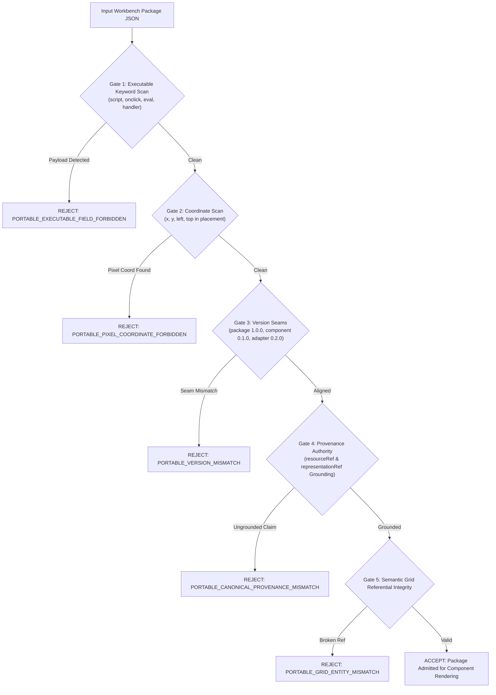

# AG_Portable_Workbench: Declarative Workbench & STEM Explorer Engineering Runbook

## Overview & Purpose

The **`ag-portable-workbench`** skill defines the canonical lifecycle, schemas, validation gates, and ergonomic rendering standards for creating, auditing, and testing interactive, tablet-ready **Declarative Portable Workbenches and STEM Explorers** across Mathematics, Chemistry, and Physics.

This skill operationalizes the **Declarative Portable Workbench Architecture (DEC-A59 / Workpack A64)**, serving as the interactive explorer analogue to **Smart Labelling (SL1 / SL2)**:
- **SL1 Analogue (Identity & Security Gate)**: Enforces authentic source provenance, exact version seams, cryptographic authority bounds (`CANONICAL_COMPILED_RESOURCE` vs. `NON_CANONICAL_COMPILED_PROOF`), and pure declarative data isolation (zero executable scripts).
- **SL2 Analogue (Cognitive Demand & State Transitions)**: Formulates state evolution as discrete declarative transformations:
  $$\text{State } S_t \xrightarrow[\text{Patch: } \Delta \mathcal{E}, \Delta \mathcal{P}]{\text{Rule } R} \text{State } S_{t+1}$$
  isolating the decisive cognitive acts across partition refinement, place-value scaffolding, electron conservation, and kinematic simultaneity.

> [!IMPORTANT]
> **Universal Governance Invariant (Rule 13 in `AGENTS.md`)**:
> *"No academic approval inferred from software validation. Green CI means automatic tests passed; it never means student release is authorized."*
> All authored packages default to `academic_admission: HOLD`.

---

## 1. The 5 Invariant Pillars of Declarative Workbenches

Every workbench must strictly satisfy the five architectural pillars (detailed in [`references/PORTABLE_WORKBENCH_BLUEPRINT.md`](references/PORTABLE_WORKBENCH_BLUEPRINT.md)):

| Pillar | Invariant | Enforcement Mechanism |
|---|---|---|
| **1. Semantic Grid Placement** | Zero pixel coordinates. Projections placed strictly by named grid, row, and column IDs. | Fails closed on any occurrence of `x`, `y`, `left`, `top`, `width`, `height` in placement. |
| **2. Fail-Closed Security** | 15 immutable rejection rules blocking scripts, version drift, and ungrounded canonical claims. | Python (`validate_workbench_package.py`) & TypeScript (`validatePortablePackage`) fail-closed scanners. |
| **3. Kid-Friendly Pedagogy** | 4-part visual guide card: Discipline Badge, Analogy Title, Mission Prompt, 3-Step Breakdown, Memory Rule/Fun Fact. | Built-in pedagogical compiler eliminating confusing compiler diagnostics. |
| **4. Reactive Visual Simulation** | Native DOM SVG plots, arithmetic scaffold brackets, electron transfer bridges, and live Squeeze-O-Meters. | Pure SVG geometry & CSS Flexbox; real-time telemetry gauges displaying numeric convergence. |
| **5. Tablet Ergonomics (WCAG AAA)** | Zero iframes, minimum 48px hit targets, semantic tables (`role="table"`), and lossless $90^\circ$ rotation. | Browser test assertions enforcing no `position: absolute`, no `translate3d`, and persistent state on rotation. |

---

## 2. The 15 Fail-Closed Rejection Invariants

The host runtime operates as a strict fail-closed boundary. Any package that violates the invariants below is rejected immediately:



Full details for each code are cataloged in [`references/FAIL_CLOSED_REJECTION_RULES.md`](references/FAIL_CLOSED_REJECTION_RULES.md).

---

## 3. The 4 Golden STEM Specimens

The skill provides four complete, authenticated golden specimens:

### 1. Riemann Sums — Partition Refinement (`golden-riemann-sums.v1.json`)
- **Domain**: Mathematics (Integral Calculus).
- **Mission**: Squeeze the area under $f(x) = x^2$ over $[0, 1]$ between lower and upper Darboux rectangles.
- **Cognitive Pivot**: Slicing the interval into finer subintervals ($N = 2 \to 4 \to 8$) monotonically decreases the Darboux gap $\Delta = U - L$ ($0.5000 \to 0.2500 \to 0.1250$), converging exactly to $\frac{1}{3} \approx 0.3333$.
- **Telemetry**: Live Squeeze-O-Meter gauge tracking convergence progress percentage.

### 2. Long Division Scaffold (`golden-long-division.v1.json`)
- **Domain**: Mathematics (Arithmetic Place-Value Scaffolding).
- **Mission**: Unpack $492 \div 4$ step-by-step into hundreds, tens, and units.
- **Cognitive Pivot**: Decomposes multi-digit division into three discrete single-digit divisions with remainders:
  1. $400 \div 4 = \mathbf{100}$ (Quotient: `1 _ _`)
  2. $90 \div 4 = \mathbf{20}$ with $1$ ten remainder (Quotient: `1 2 _`)
  3. $12 \div 4 = \mathbf{3}$ (Final quotient: `123`)

### 3. Redox Reactions — Electron Conservation (`golden-redox-equivalence.v1.json`)
- **Domain**: Chemistry (Electrochemistry & Redox Reactions).
- **Mission**: Prove electron conservation between $\text{Fe}^{2+}$ and $\text{Ce}^{4+}$.
- **Cognitive Pivot**: $\text{Fe}^{2+} \to \text{Fe}^{3+} + 1e^-$ (Oxidation is Loss) perfectly balances $\text{Ce}^{4+} + 1e^- \to \text{Ce}^{3+}$ (Reduction is Gain), demonstrating $1e^- \text{ Lost} = 1e^- \text{ Gained}$.

### 4. Motion Shared Clock (`golden-motion-shared-clock.v1.json`)
- **Domain**: Physics (2D Kinematics & Simultaneity).
- **Mission**: Connect independent horizontal ($X$) and vertical ($Y$) motion under a single shared clock.
- **Cognitive Pivot**:
  - Recombining $x(2\text{s})$ and $y(2\text{s})$ $\to$ **ACCEPTED** (Valid simultaneous physical coordinate).
  - Mixing $x(2\text{s})$ with $y(3\text{s})$ $\to$ **REJECTED** (Violates single physical state invariant).

---

## 4. Operational Build Procedure

When authoring or modifying an interactive workbench, execute these sequential steps:

1. **Step 1: Declarative Schema Authoring**:
   Author the package JSON according to `portable-workbench-package` schema version `1.0.0`, declaring semantic grids, initial entities, and adapter rules.
2. **Step 2: Fail-Closed Static Audit**:
   Execute the static validator:
   ```bash
   python scripts/validate_workbench_package.py <package.json>
   ```
3. **Step 3: Kid-Friendly Guide & SVG Component Binding**:
   Register educational metadata in `web/applications/portable/component.ts`:
   - Set up `getKidGuide` (analogy title, mission prompt, 3-step breakdown, memory rule).
   - Implement `renderVisualGraphic` (pure SVG curves/diagrams, live telemetry gauge, CSS Flexbox).
   - Add friendly rule titles and subtitles in `getRuleFriendly`.
4. **Step 4: DOM & Ergonomic Audit**:
   Run the headless HTML validator:
   ```bash
   node --experimental-strip-types scripts/verify_component_html.js
   ```
5. **Step 5: Full Test Suite Execution**:
   Run the runtime and browser test suites:
   ```bash
   node --test --experimental-strip-types tests/browser/portable.spec.ts tests/runtime/test_portable_math_workbenches.spec.ts tests/runtime/test_portable_chem_workbenches.spec.ts tests/runtime/test_portable_physics_workbenches.spec.ts
   ```
6. **Step 6: Build & Packaging**:
   Rebuild the production bundle:
   ```bash
   npm run build && python scripts/copy_public_to_dist.py
   ```
