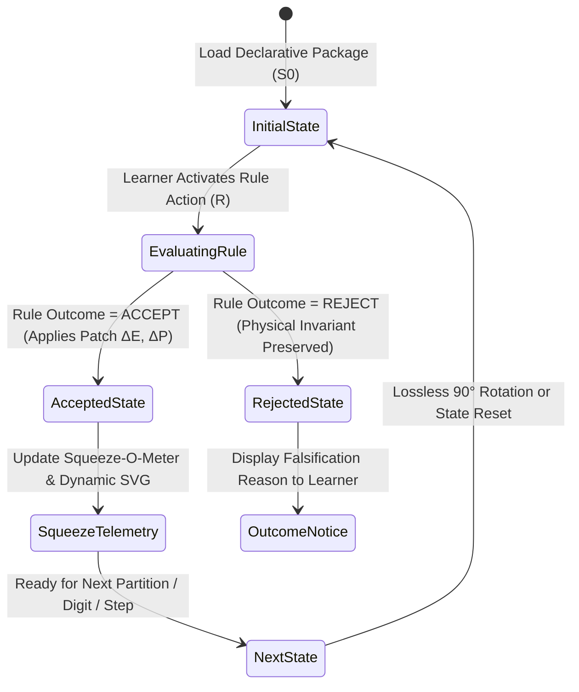

# Declarative Portable Workbench & Interactive Explorer Architectural Blueprint
## Architectural Standard, Cognitive State Transitions, and Pedagogical Contracts (A64 / DEC-A59)

---

## 1. Executive Summary & Purpose

The **Declarative Portable Workbench Blueprint** defines the canonical data architecture, cognitive state transitions, pedagogical scaffolds, and fail-closed security invariants for interactive STEM explorers across Mathematics, Chemistry, and Physics.

This blueprint operationalizes **Workpack A64 / DEC-A59-PORTABLE-COMPATIBILITY-01**, guaranteeing that:
1. All scientific, arithmetic, and geometric state representations are **100% declarative, serializable, and data-driven** (zero executable scripts inside data packages).
2. The UI is **kid-friendly, engaging, and pedagogically transparent**, featuring visual curve plots, arithmetic brackets, electron balance beams, stroboscopic motion monitors, and live telemetry gauges (e.g. Squeeze-O-Meter).
3. The host rendering enforces **zero iframes, zero pixel-coordinate positioning (`position: absolute`), and minimum 48px touch ergonomics** conforming to WCAG 2.5.5 AAA on 12.7" tablets.

---

## 2. Cognitive State Transition Model

Every workbench package is modeled as a discrete declarative state machine:

$$\mathcal{M} = \langle \mathcal{S}, \mathcal{G}, \mathcal{E}, \mathcal{P}, \mathcal{T}, \mathcal{R}, \mathcal{A} \rangle$$

Where:
- $\mathcal{S}$ is the **Scene Definition** containing grids, entities, projections, targets, and transformations.
- $\mathcal{G}$ is the set of **Semantic Grids** with named rows $R = \{r_1, r_2, \dots\}$ and columns $C = \{c_1, c_2, \dots\}$.
- $\mathcal{E}$ is the set of **Domain Entities** representing physical or mathematical truths (e.g. Partitions $P_n$, Half-Cells $\text{Fe}^{2+}$, or Kinematic Samples $x(2\text{s})$).
- $\mathcal{P}$ is the set of **Scene Projections**, mapping entities to specific grid coordinates:
  $$\text{placement} = \{ \text{grid}: g_k, \text{row}: r_i, \text{column}: c_j \}$$
  *(Absolute $(x, y)$ pixel coordinates are strictly forbidden fail-closed).*
- $\mathcal{T}$ is the set of **Canonical Transformations** binding source entities to target operations.
- $\mathcal{R}$ is the set of **Declarative Adapter Rules**:
  $$\text{Rule}(id) \colon \text{State } S_t \xrightarrow[\text{Patch: } \Delta \mathcal{E}, \Delta \mathcal{P}]{\text{ACCEPT / REJECT}} \text{State } S_{t+1}$$
- $\mathcal{A}$ is the **Audit Provenance Badge** declaring the authority (`CANONICAL_COMPILED_RESOURCE` or `NON_CANONICAL_COMPILED_PROOF`).



---

## 3. The 5 Invariant Pillars

### Pillar 1: Declarative Semantic Grids & Zero Pixel Coordinates
- Projections must be placed strictly by referencing named semantic grids, rows, and columns.
- **Fail-Closed Rule**: Any package containing `x`, `y`, `left`, `top`, `width`, or `height` inside `placement` is immediately rejected under `PORTABLE_PIXEL_COORDINATE_FORBIDDEN`.
- CSS styling inside rendered HTML must never use `position: absolute` or `translate3d`. All responsive layouts use CSS Flexbox, semantic HTML tables (`role="table"`), and inline SVGs.

### Pillar 2: 15 Fail-Closed Security & Provenance Invariants
- Enforces strict version seams:
  - `schemaVersion`: `'portable-workbench-package'`
  - `packageVersion`: `'1.0.0'`
  - `componentApiVersion`: `'0.1.0'`
  - `transformationIrVersion`: `'0.1.0'`
  - `adapterApiVersion`: `'0.2.0'`
  - `scenePackageVersion`: `'1.0.0'`
  - `declarativeAdapterId`: `'declarative-transfer-v1'`
- Scans keys and values recursively, instantly rejecting any executable payloads (`script`, `javascript`, `eval`, `function`, `onclick`, `onload`, `onerror`).
- Enforces cryptographic groundings for canonical resources (`resourceRef`, `representationRef`, `sourceRefs`).

### Pillar 3: Kid-Friendly Educational Layer (The 4-Part Guide)
Every workbench must include a dedicated visual guide card containing:
1. **Discipline Badge & Analogy Title**: Plain-language title that removes intimidating technical jargon (e.g. *"The Squeeze Machine — Trapping the Area Under a Curve"*).
2. **Mission Statement**: A clear 1-2 sentence real-world goal (e.g. *"Trap the exact area under the curvy slide $f(x) = x^2$ from 0 to 1!"*).
3. **3-Step Rule Breakdown**: Bulleted, color-coded breakdown of lower estimates, upper estimates, and how the squeeze works.
4. **Memory Rule or Fun Fact**: An easy mnemonic or conceptual insight (e.g. *"OIL RIG — Oxidation Is Loss, Reduction Is Gain"*).

### Pillar 4: Reactive Native Visual Simulation & Live Telemetry
Directly below the mission card, the workbench renders a high-fidelity visual simulation:
- **Riemann Sums**:
  - Dynamic SVG plot of $f(x) = x^2$ on $[0, 1]$.
  - Blue under-estimate rectangles (translucent fill `#bfdbfe`, solid blue border `#3b82f6`).
  - Amber over-estimate rectangles (translucent fill `#fef3c7`, dashed border `#f59e0b`).
  - Green dashed line at true area $\int_0^1 x^2 dx = 1/3 \approx 0.3333$.
  - **Live Squeeze-O-Meter**: Real-time progress bar showing Darboux gap $\Delta = U - L$ and convergence percentage.
- **Long Division**:
  - Color-coded arithmetic tableau bracket ($4 \big) \overline{492}$).
  - Place-value cards tracking Hundreds ($400 \div 4 = 100$), Tens ($90 \div 4 = 20$, rem 1 ten), and Units ($12 \div 4 = 3$).
- **Redox Reactions**:
  - Electrochemical dual half-cell transfer diagram.
  - Iron oxidation beaker ($\text{Fe}^{2+} \to \text{Fe}^{3+} + 1e^-$) and Cerium reduction beaker ($\text{Ce}^{4+} + 1e^- \to \text{Ce}^{3+}$).
  - Glowing transfer bridge showing electron conservation ($1e^- \text{ Lost} = 1e^- \text{ Gained}$).
- **Motion Shared Clock**:
  - Stroboscopic 2D sensor timeline logging horizontal position $x(t=2\text{s})$ and vertical position $y(t=2\text{s})$.
  - Central clock evaluator confirming simultaneity (ACCEPT) versus mixed-time rejection (REJECT).

### Pillar 5: Tablet Ergonomics & Zero-Iframe Policy
- **Zero Iframes**: All components mount directly into the native browser DOM.
- **48px Minimum Hit Targets**: All action buttons, projection pills, and rotate controls have `min-height: 48px; min-width: 48px;`.
- **Lossless $90^\circ$ Rotation**: Users can rotate the workbench orientation without losing active transformations or dynamic projections.

---

## 4. Subject Exemplar Matrices

| Package ID | Domain | Initial Entities | Key Transformations | Visual Simulation | Squeeze / Telemetry Gauge |
|---|---|---|---|---|---|
| `portable-integration-riemann` | Mathematics (Calculus) | Partition $P_2$ ($L=0.1250, U=0.6250$) | `rule-refine-n4`, `rule-refine-n8` | SVG $y=x^2$ with lower/upper rectangles | Squeeze-O-Meter ($\Delta = 0.5 \to 0.25 \to 0.125 \to 1/3$) |
| `portable-long-division` | Mathematics (Arithmetic) | Setup $492 \div 4$ | `rule-first-quotient-digit`, `rule-second-quotient-digit` | Long division bracket tableau | Place-value cards ($100 + 20 + 3 = 123$) |
| `portable-redox-electron-equivalence` | Chemistry (Physical) | $\text{Fe}^{2+}$ (Source), $\text{Ce}^{4+}$ (Source) | `rule-equate-redox-electrons` | Dual half-cell electron transfer | Balance scale ($1e^- \text{ lost} = 1e^- \text{ gained}$) |
| `portable-motion-shared-clock` | Physics (Kinematics) | Candidate $x(2\text{s}), y(2\text{s})$ vs $x(2\text{s}), y(3\text{s})$ | `same-time` (ACCEPT), `mixed-time` (REJECT) | Stroboscopic 2D trajectory monitor | Master Clock Watchdog ($t=2.0\text{s}$ Simultaneity) |

---

## 5. Dual-Engine Verification Protocol

To certify a workbench package for student and authoring use, run both engines:

1. **Engine 1: Fail-Closed Static Contract Audit (Python)**:
   ```bash
   python scripts/validate_workbench_package.py <package.json>
   python scripts/audit_workbench_fixtures.py
   ```
2. **Engine 2: Dynamic DOM & Ergonomic Audit (Node / Chromium)**:
   ```bash
   node --experimental-strip-types scripts/verify_component_html.js
   node --test --experimental-strip-types tests/browser/portable.spec.ts tests/runtime/test_portable_math_workbenches.spec.ts
   ```
