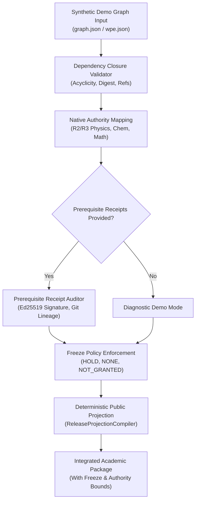

# Academic Release Compiler Integration and Native Authority Architecture

## 1. Executive Summary & Governing Authority

Workpack **A40** establishes the formal integration bridge between the native R2/R3 authority frameworks, the external independent acceptance receipt protocol, dependency closure validation, and the deterministic release projection compiler in Grade9v4.2.

Under the governing Owner delivery policy (2026-11-17) and `AGENTS.md` direct bounds:
- **Academic Admission:** Strictly `HOLD`. No author, script, or automated tool can self-admit academic materials without verified external signed authority.
- **Production Release Authority:** Strictly `NONE`. Target mode is bounded strictly to `DEMO` projections. Any attempt to enable production releases raises `ProductionReleaseProhibitedError`.
- **UI Freeze Status:** Strictly `NOT_GRANTED`. Zero learner-facing UI may be published prior to signed independent A61 acceptance.
- **Custody Boundary:** All private review receipts, detached cryptographic signatures, signing keys, and audit logs must reside strictly *outside* the target repository.
- **Dual-Source Immutability:** Both migration sources (Grade9v3.5 `8a02a8eb` and Grade9v4.1 `564ad2a0`) remain read-only and immutable.

```
+-----------------------------------------------------------------------------------------+
|                                EXTERNAL CUSTODY BOUNDARY                                |
|  [External Trust Roster]   [Detached Ed25519 Signatures]   [Independent Review Receipts]|
+-----------------------------------------------------------------------------------------+
                                          |  (Audited via ReceiptVerifier & openssl)
                                          v
+-----------------------------------------------------------------------------------------+
|                    GRADE9V4.2 ACADEMIC RELEASE INTEGRATION COMPILER                     |
|                                                                                         |
|  1. Input Snapshot & Fixture Intake (Synthetic Demo Graphs: graph.json, wpe.json)       |
|  2. Structural Envelope & DAG Dependency Closure (ObjectGraphValidator)                 |
|  3. Native R2/R3 Authority Mapping (Physics, Chemistry, Math; Biology Pending)          |
|  4. Independent Receipt Verification (Scope, Signatures, Expiration, Anti-Self-Approval) |
|  5. R3 Freeze Enforcement (FREEZE_PENDING_GOLDEN, D3.1 PAUSED, Production: NONE)        |
|  6. Public-Safe Deterministic Projection Compilation (Zero Private Solutions/Rubrics)   |
+-----------------------------------------------------------------------------------------+
                                          |
                                          v
                         [Public-Safe Synthetic Diagnostic Package]
```

---

## 2. Native R2/R3 Authority Mapping

Grade9v4.2 formally maps curriculum disciplines, Core roles, and projection contracts to the native authority specifications established in Grade9v3.5 and Grade9v4.1.

### 2.1 Subject Authority Ledger

| Subject | Native Authority ID | Status | Admitted | Approved Scope | Controlling Contract Reference |
| :--- | :--- | :--- | :--- | :--- | :--- |
| **PHYSICS** | `AUTH-R3-PHY` | `HOLD` | `False` | `VALIDATED_SYNTHETIC_ONLY` | `Shared/roles/CORE-AUTHORITY-CONTRACT.md` |
| **CHEMISTRY** | `AUTH-R3-CHE` | `HOLD` | `False` | `VALIDATED_SYNTHETIC_ONLY` | `Shared/roles/CORE-AUTHORITY-CONTRACT.md` |
| **MATHEMATICS** | `AUTH-R3-MAT` | `HOLD` | `False` | `VALIDATED_SYNTHETIC_ONLY` | `Shared/roles/CORE-AUTHORITY-CONTRACT.md` |
| **BIOLOGY** | `AUTH-R3-BIO-PENDING` | `SCOPE_PENDING` | `False` | `NONE` | Curriculum extension pending explicit Owner adoption |

### 2.2 Core Role and Projection Contract Mapping

Native roles and projection schemas defined in `01-architecture/native-contract-mapping.json` and `00-authority/v35-observed-native-pins.json` are bound as follows:

| Projection Type | Target Schema Path | Native Authoritative Reference | Native Role / Purpose | Authority Status |
| :--- | :--- | :--- | :--- | :--- |
| `SOURCE` | `schemas/v1/source.schema.json` | `Shared/library/source_custody.py` | Immutable question source custody | `HOLD` |
| `WARRANT` | `schemas/v1/warrant.schema.json` | `Shared/library/package.schema.json` | Scientific warrant & derivation | `HOLD` |
| `CONSTRUCTION` | `schemas/v1/construction.schema.json` | `Shared/roles/CORE1A.md` | Core 1A physical model construction | `HOLD` |
| `LESSON` | `schemas/v1/lesson.schema.json` | `Shared/roles/CORE1A.md` | Core 1A instructional scaffolding | `HOLD` |
| `ASSESSMENT` | `schemas/v1/assessment.schema.json` | `Shared/roles/CORE1B.md` | Core 1B phenomenological reconstruction | `HOLD` |
| `APPROVAL` | `schemas/v1/approval.schema.json` | `Shared/tools/review_authority.py` | Scoped academic approval token | `HOLD` |
| `QUESTION` | `nsejs/core2/question-map.v1.json` | `Shared/roles/CORE2.md` | Core 2 question banking & taxonomy | `HOLD` |
| `RELATIONSHIP` | `schemas/v1/relationship.schema.json` | `Shared/roles/LEARNER-PRODUCT-TEMPLATES.md` | Six-Core traversal relationship graph | `HOLD` |

---

## 3. Immutable Freeze Policy & Authority Invariants

The upstream R3 freeze policy remains in full effect and cannot be modified or bypassed:

```json
{
  "freeze_status": "FREEZE_PENDING_GOLDEN",
  "academic_admission": "HOLD",
  "production_release": "NONE",
  "ui_freeze": "NOT_GRANTED",
  "accepted_golden": null,
  "production_enabled": false,
  "academic_release_enabled": false,
  "d3_1_status": "PAUSED",
  "frozen_legacy_preview_pin": "7a5c425f02d8a365a738bb11df1982cbe38e9f82",
  "external_trust_required": true,
  "self_approval_permitted": false
}
```

### Invariant Rules
1. **Target Mode Locking:** `target_mode` must be `"DEMO"`. Any attempt to specify `"PRODUCTION"` raises `ProductionReleaseProhibitedError("PRODUCTION_TARGET_PROHIBITED")`.
2. **Academic Admission Locking:** `academic_admission` must be `"HOLD"`. Any attempt to admit academic objects without signed external authority raises `AcademicAdmissionError`.
3. **No Self-Approval:** Neither the compiler nor the author can generate or sign approval receipts for their own work.
4. **D3.1 Pause:** Dynamic interactive learner features (D3.1) remain strictly paused pending golden ratification.

---

## 4. Independent Acceptance Receipt Protocol

The independent receipt verification protocol implements strict cryptographic and temporal checks complying with `08-review/receipt-protocol.md` and `07-orchestration/check.py`.

### 4.1 Receipt Schema & Fields

Every valid receipt (`<workpack>.json`) must provide:
- `workpack`: Target workpack ID (e.g. `A39`, `A40`). Regex: `^A\d{2}$`.
- `decision`: Must be strictly `"ACCEPTED"`. Statuses such as `"SUBMITTED_FOR_REVIEW"`, `"PENDING"`, `"REJECTED"`, or `"HOLD"` are rejected immediately with `INVALID_DECISION`.
- `base_commit`: 40-character lowercase hexadecimal Git commit SHA.
- `candidate_commit`: 40-character lowercase hexadecimal Git commit SHA.
- `candidate_tree`: 40-character lowercase hexadecimal Git tree SHA.
- `kit_manifest_sha256`: 64-character SHA-256 digest matching the external R4 Execution Kit manifest (`6f92aac8eb1ca42e46d243443b230e2bb83dae5e99beeee872da6da47b04e3fc`).
- `reviewer_id`: Authorized reviewer ID matching an externally configured trust roster.
- `reviewed_at`: ISO 8601 UTC timestamp.
- `test_evidence_sha256`: 64-character SHA-256 digest of the reviewer's test execution evidence bundle.

### 4.2 Detached Cryptographic Signature Verification

Each receipt `<workpack>.json` is accompanied by a detached signature `<workpack>.sig`:
1. The receipt JSON is canonicalized using RFC 8785 byte canonicalization (`canonical_bytes`).
2. The detached signature is verified using OpenSSL's Ed25519 engine (`openssl pkeyutl -verify -pubin -inkey keyfile -rawin -in receipt.json -sigfile receipt.sig`).
3. If the signature is missing or empty, `ReceiptVerificationError("UNSIGNED_RECEIPT")` is raised.
4. If the signature does not match the canonical JSON bytes, `ReceiptVerificationError("TAMPERED_RECEIPT")` is raised.

### 4.3 Rejection Gates & Anti-Tampering Controls

```
                        +----------------------------+
                        |   Receipt JSON & Detached  |
                        |     Ed25519 Signature      |
                        +----------------------------+
                                      |
                                      v
                        [Missing / Empty Sig?] ----YES----> [REJECT: UNSIGNED_RECEIPT]
                                      | NO
                                      v
                        [Ed25519 Verify Fails?] --YES-----> [REJECT: TAMPERED_RECEIPT]
                                      | NO
                                      v
                        [Future / Expired TTL?] --YES-----> [REJECT: STALE_RECEIPT]
                                      | NO
                                      v
                        [Reviewer == Author?] ----YES-----> [REJECT: SELF_APPROVAL_PROHIBITED]
                                      | NO
                                      v
                        [Reviewer in Roster?] ----NO------> [REJECT: UNAUTHORIZED_REVIEWER]
                                      | YES
                                      v
                        [Kit Hash Mismatch?] -----YES-----> [REJECT: SCOPE_MISMATCH]
                                      | NO
                                      v
                        [Decision != ACCEPTED?] --YES-----> [REJECT: INVALID_DECISION]
                                      | NO
                                      v
                        [Git Tree Mismatch?] -----YES-----> [REJECT: TREE_MISMATCH]
                                      | NO
                                      v
                        [Lineage Disconnected?] --YES-----> [REJECT: LINEAGE_MISMATCH]
                                      | NO
                                      v
                        [External Custody Breach?] YES----> [REJECT: EXTERNAL_CUSTODY_VIOLATION]
                                      | NO
                                      v
                        +----------------------------+
                        |  RECEIPT_VALIDATED (PASS)  |
                        +----------------------------+
```

---

## 5. Dependency Closure Verification Engine

`DependencyClosureValidator` guarantees the structural integrity of the knowledge graph prior to compilation:
1. **Uniqueness:** All object IDs are unique non-empty strings.
2. **Resolution:** Every object referenced in `dependencies` and `source_lineage_refs` exists in the graph.
3. **Digest Integrity:** Every referenced exact ref `{type, id, revision, sha256}` matches the canonical SHA-256 digest of the referenced target object.
4. **DAG Acyclicity:** Dependency edges are acyclic (directed acyclic graph). Directed cycles raise `DependencyClosureError`.
5. **Subject Isolation:** Dependencies must remain within the same `subject_id` unless an explicit bridge relationship object is defined. Cross-subject leakage raises `DependencyClosureError`.
6. **Zero Secret Disclosure:** The compiled public projection strictly excludes operator-only artifacts:
   - `learner_postcommit: []`
   - `assessment_contracts: []`
   - `search_index: []`
   - Solutions, scoring rubrics, worked steps, and private diagnosis prompts are completely purged from public bundles.

---

## 6. Academic Release Compiler Integration Pipeline

The `AcademicReleaseIntegrator` orchestrates the complete end-to-end pipeline:



### Generated Package Attributes
- `schema_version`: `"g9-release-projection/1.1"`
- `target_mode`: `"DEMO"`
- `demo_banner`: `True`
- `academic_admission`: `"HOLD"`
- `production_release`: `"NONE"`
- `ui_freeze`: `"NOT_GRANTED"`
- `compiler_integration_status`: `"FROZEN_ACADEMIC_DEMO_COMPLIANT"`
- `r3_freeze_policy`: Bound immutable copy of `R3_FREEZE_POLICY`
- `native_authorities`: Bound native R2/R3 subject authorities
- `native_contract_mapping`: Bound native projection contract map
- `dependency_closure`: Verified object counts and canonical graph digest

---

## 7. Security and Custody Architecture

1. **Isolation of Signing Keys and Receipts:**
   - Keys and receipts must never be placed inside the target repository.
   - `PrerequisiteAuditor` verifies that `receipts_dir` and `keyfile` are external to `repo_path`.
2. **Defensive Verification Order:**
   - Schema validation precedes signature verification.
   - Signature verification precedes git graph traversal.
   - Authority status check precedes projection generation.
3. **No Environment-Specific Compromises:**
   - Uses RFC 8785 canonical JSON formatting.
   - Deterministic digests ensure byte-for-byte reproducible build artifacts.
